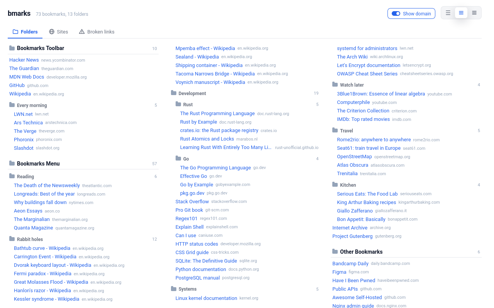

# bmarks

All your Firefox bookmarks on one page.



- Every folder open, in columns. Ctrl+F finds anything.
- Drag to move or reorder. Delete with undo, rename from the right
  click menu.
- Group by site, or open a single folder.
- Check every link and find the dead ones.

Nothing leaves your browser. The link check contacts only the sites
you bookmarked, and only when you run it.

## Develop

```sh
npm ci
npm start      # Firefox with the add-on loaded
npm test
npm run lint
```

## License

MIT
